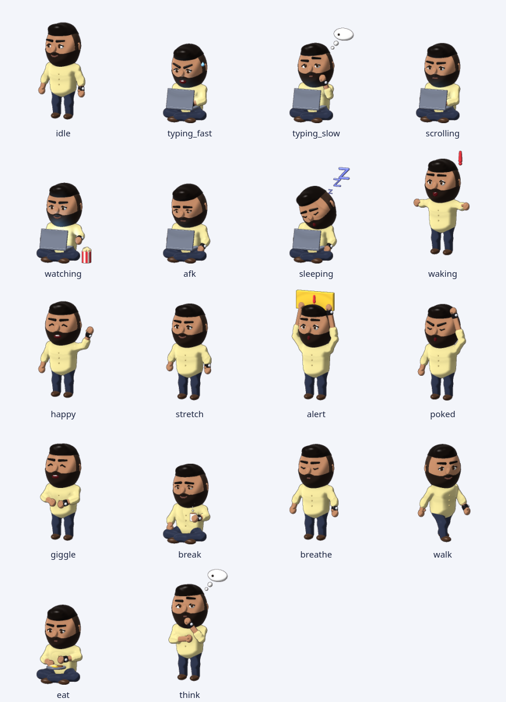
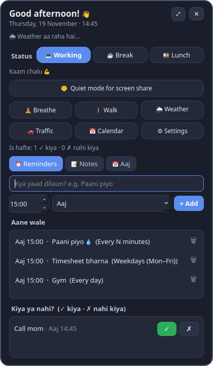
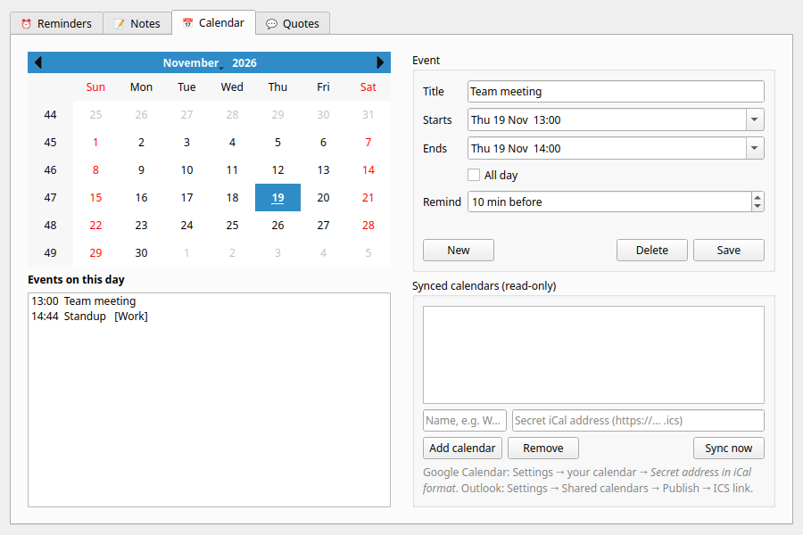
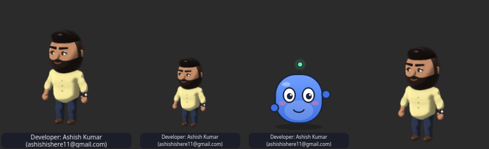

# Saarthi

**Your animated desktop companion (सारथी, "the one who guides your chariot").**
It lives on your screen and reacts to what you're doing: type fast and it sweats, pause to think and it
ponders, watch a tutorial and it takes notes (a funny video gets popcorn), walk away and it falls asleep. It also keeps your
reminders and notes, takes breaks and lunch with you, breathes with you, and tells you the traffic home.



<sub>The default 3D character, Saarthi. Prefer a cartoon robot? Pick **Bit** from right-click → Character.</sub>

| Platform | Status |
|---|---|
| Linux (Ubuntu / Debian / Fedora / Arch; X11 and Wayland) | ✅ Tested |
| Windows 10 / 11 | ⚠️ Code complete, real-machine testing pending |
| macOS 12+ | ⚠️ Code complete, real-machine testing pending |

📄 **Docs:** [Features & user guide (PDF)](docs/Saarthi-Features-Guide.pdf) ·
[Technical documentation (PDF)](docs/Saarthi-Technical.pdf)

## Features

- **Knows what you're doing**: fast/slow typing, scrolling (mouse or touchpad), away, asleep, and what's
  playing, told apart as **music**, a **tutorial** or **any other video** from its title and channel
  (YouTube, YouTube Music, Udemy, Coursera…). Counts *how fast* you type, never *what*.
- **18 states, 30+ animations** with the 3D **Saarthi** character by default, the cartoon robot **Bit**,
  your own skins, and a **3D avatar maker** for a full-body character of yourself
- **Acts the part**: notes, hand on chin or trying the code during a tutorial; popcorn, a laugh or a cold
  drink for other videos; headphones and a head bob for music; sits down worn out on a low battery;
  fans itself when the laptop is hot
- **Alive when you touch it**: poke its head, tickle its belly, step on its shoes, tug its jeans, click
  too much and it gets dizzy; only the character itself is clickable (clicks around it reach the window
  behind); drag it anywhere; **walking mode** strolls along your screen
- **Watches the laptop too**: battery below 15% / 10% (tired look and a red battery icon), loud at 5%;
  happy when you plug in, "unplug at 100%"; fans itself when the CPU runs hot; internet gone / back;
  "restart, it's been 3 days"; headphones in/out; mute and volume past 100%; "go to sleep" after
  midnight; moves to the bigger screen when you plug in a monitor. On Linux it reacts the moment the system reports a
  change (UPower, NetworkManager, `pactl subscribe`) instead of polling; CPU load is sampled every 5 s
- **Status: Working / Break / Lunch**: pick the minutes; it goes on a chai break or eats lunch, then
  strolls and thinks; click the status again to end it, or change the time while it runs
- **Breaks and guided breathing**: break after 50 min of work (cancelled if you keep typing on
  something important), breathing every 20 min (in 4 s, hold 2 s, out 6 s)
- **🤫 Quiet mode** for screen sharing: tiny in a corner, no pop-ups; reminders wait for you
- **Reminders** (once, daily, weekdays, weekly, monthly, hourly, every N min) with
  ✓ Done / ✗ Skipped tracking and a weekly score; **notes** that work as a to-do list
- **Calendar** with your events plus read-only Google / Outlook / Apple sync (iCal links)
- **Quote lists** (ships with a no-smoking list: lungs, heart, hair, skin and brain facts)
- **Lines that don't repeat**: every list takes turns; useful tips while you scroll for a long time
  (Ctrl+F, 20-20-20, posture…) or watch a tutorial (code along, J to rewind, captions…)
- **Morning brief** at the time you choose, **weather** (outfits, rain warnings) and **traffic home before logout**
- **State schema** (`schema.py`): everything that drives the character, in one Pydantic model, optionally
  sent to another app (e.g. your Glitch) with `glitch_url`
- **💑 Couple mode** (one switch): a live link where someone can watch your Saarthi from their phone, tap
  it, kick a football at it, hug, kiss or be angry with it, and **chat** with you; it all plays on your
  desktop too, and a green dot shows when they're watching
- Double-click **panel** (dark/light), a full window, **What I see…** live diagnostics and a
  **🧪 Try features** menu to trigger anything on demand
- Hinglish or English, one-command installers, start with your computer, one instance only

---

## Install

You need **git** and **Python 3.10+**. Nothing needs admin rights except installing those two
(and, on Linux Wayland, one optional permission). Everything else goes into your user folder.

<details open>
<summary><b>🐧 Linux, end to end</b></summary>

**1. Prerequisites**

```bash
# Ubuntu / Debian / Mint / Pop!_OS
sudo apt update && sudo apt install -y git python3 python3-venv libxcb-cursor0 libxkbcommon-x11-0 libegl1

# Fedora
sudo dnf install -y git python3 xcb-util-cursor libxkbcommon-x11 mesa-libEGL

# Arch / Manjaro
sudo pacman -S --needed git python xcb-util-cursor libxkbcommon-x11
```

**2. Get the code and install**

```bash
git clone https://github.com/Ashish04Kumar/saarthi.git
cd saarthi
./install.sh                 # or: ./install.sh --autostart   (start with your computer)
```

The installer creates a private virtualenv in `~/.local/share/saarthi`, adds **Saarthi** to your app
menu (with icon) and the `saarthi` command to `~/.local/bin`, then starts it.

**3. Let it see your typing (Wayland only, one time)**

Ubuntu and most modern distros use Wayland, which hides keyboard activity from apps.
Check with `echo $XDG_SESSION_TYPE`. If it prints `wayland`:

```bash
sudo usermod -aG input $USER
```

Then **log out and back in** (Saarthi already picks it up on its next start even before that).
This lets programs you run read input devices; Saarthi only counts key presses.
Prefer not to? Choose **"Ubuntu on Xorg"** from the ⚙ on the login screen instead. On X11 nothing is needed.

**4. Check it works**

Right-click the character → **What I see…**: *Typing & scroll* should say `evdev` (Wayland) or
`pynput` (X11), and *Keys / sec* should rise while you type anywhere.

**5. Everyday commands**

```bash
saarthi            # start (or use the app menu)
saarthi --quit     # stop
saarthi --demo     # start and cycle through every animation
```

**Update:** `cd saarthi && git pull && ./install.sh` ·
**Uninstall:** `./install.sh --uninstall` (your notes and settings in `~/.config/saarthi` are kept)

</details>

<details>
<summary><b>🪟 Windows 10 / 11, end to end</b></summary>

**1. Prerequisites** (PowerShell or Command Prompt)

```powershell
winget install Python.Python.3.12
winget install Git.Git
```

Or download Python from [python.org](https://www.python.org/downloads/windows/) and **tick
"Add python.exe to PATH"** in the installer. Close and reopen the terminal afterwards.
(No git? Use **Code → Download ZIP** on GitHub and unzip it.)

**2. Get the code and install**

```powershell
git clone https://github.com/Ashish04Kumar/saarthi.git
cd saarthi
.\install.bat
```

Or simply **double-click `install.bat`** in the folder. If Windows SmartScreen warns about the script,
click *More info → Run anyway* (it's plain PowerShell you can read in `install.ps1`).
The installer creates `%LOCALAPPDATA%\Saarthi`, adds **Saarthi** to the Start menu and Desktop,
then starts it. To start with Windows: `powershell -ExecutionPolicy Bypass -File install.ps1 -Autostart`
(or right-click the character → *Start with my computer*).

**3. Check it works**

Typing detection needs no setup on Windows. Right-click the character → **What I see…**:
*Typing & scroll* should say `pynput`, and *Keys / sec* should rise while you type.

**4. Everyday use**

Start from the Start menu. Stop with right-click → **Quit**.
**Update:** `git pull` then run `install.bat` again ·
**Uninstall:** `powershell -ExecutionPolicy Bypass -File install.ps1 -Uninstall`
(your data in `%APPDATA%\Saarthi` is kept)

</details>

<details>
<summary><b>🍎 macOS 12+, end to end</b></summary>

**1. Prerequisites** (Terminal)

```bash
xcode-select --install          # git + command line tools
```

Install Python 3.10+ from [python.org](https://www.python.org/downloads/macos/) or with
[Homebrew](https://brew.sh): `brew install python`.

**2. Get the code and install**

```bash
git clone https://github.com/Ashish04Kumar/saarthi.git
cd saarthi
./install.sh                    # or: ./install.sh --autostart   (start at login)
```

It creates `~/Library/Application Support/Saarthi/app`, adds **Saarthi.app** to `~/Applications`
(no Dock icon, it lives on your screen and in the menu bar) and starts it.

**3. Allow typing detection (one time)**

On first start macOS asks for permissions. If not, open **System Settings → Privacy & Security** and
turn on **Saarthi** (or **Python**) under **Accessibility** and **Input Monitoring**, then run
`saarthi --quit` and open Saarthi again. It only counts key presses.

**4. Everyday commands**

```bash
saarthi            # start (or open ~/Applications/Saarthi.app)
saarthi --quit     # stop
```

**Update:** `git pull && ./install.sh` · **Uninstall:** `./install.sh --uninstall`
(your data in `~/Library/Application Support/Saarthi` is kept)

</details>

### For developers

```bash
python3 -m venv .venv
.venv/bin/pip install -e ".[dev]"     # Windows: .venv\Scripts\pip install -e ".[dev]"
.venv/bin/saarthi --demo
.venv/bin/pytest                      # 55 tests, incl. end-to-end scenarios on an offscreen app
.venv/bin/ruff check src tests
python tools/docs/build_pdfs.py       # rebuild the PDFs (needs: pip install reportlab)
```

## Using it

| Do this | What happens |
|---|---|
| **Double-click** | Panel: status, quiet mode, quick actions, reminders, notes, today |
| **Right-click** | Menu: status, quiet mode, 🧪 Try features, What I see…, settings |
| **Click** | Head: poke · belly: tickle · jeans: tug · shoes: stomp (4 quick clicks: dizzy) |
| **Drag** | Move it anywhere |



## Reminders, notes & calendar

Right-click → *Open Saarthi…* for the full window.



When something is due, the buddy holds up a sign and a card pops up next to it:


**Sync Google Calendar:** Google Calendar → Settings → your calendar → *Secret address in iCal
format* → paste it in the Calendar tab. It refreshes every 15 minutes. Keep that link private:
anyone who has it can read your calendar.

**Morning brief:** once a day, the first time you're at the laptop after the time you set
(Settings → Weather → *Morning brief at*, default 05:00): today's events and reminders plus the weather.
A closed lid or a shut-down laptop just delays it until you're back.

Everything is stored locally in `data.json` in your config folder.

## Weather & traffic home


- Weather is from [Open-Meteo](https://open-meteo.com) (free, no key). Location is either a city
  you pick or an approximate city from your IP (via ipapi.co / ipinfo.io).
- Set home, office, logout time and work days in **Settings**. Before logout you get:


| Traffic data | Live traffic | Key |
|---|---|---|
| Free estimate | No (OpenStreetMap route + rush-hour guess) | none |
| TomTom | Yes | free at developer.tomtom.com, no card |
| Google Maps | Yes (most accurate in India) | Routes API key, needs billing |

Addresses are looked up with OpenStreetMap Nominatim only when you press *Search*.

## Who goes first

Saarthi has a lot going on, so it follows a few simple rules:

1. **You win.** Grabbing it stops a walk; your clicks get an instant reaction.
2. **Breaks and breathing** pause chit-chat, quotes and strolls. Reminders still pop up as cards.
   Keep typing for ~45 s during a break (~10 s during breathing) and it assumes something important
   came up: the session is cancelled and the break is offered again 15 minutes later.
3. **Speech bubbles take turns.** Reminders and replies to you are never cut off by chit-chat:
   less important lines wait their turn, and idle chatter is simply skipped if something is showing.
4. **It doesn't wander off** while typing, while a panel or card is open next to it, or during a session.
5. **Nothing nags while you're away or deep in work**: quotes and breathing wait when you're typing fast,
   watching a video, or away. Scroll tips only come after 2 minutes of scrolling, then at most every 10.
6. **What the character shows**, top wins: your click / a reminder / a session → a video (unless you're
   typing) → asleep / away → typing → scrolling → standing. While standing: music (headphones) beats a
   low battery (sitting, tired) beats a hot laptop (fanning), except below 5% battery.

Right-click → **What I see…** shows the current session and what's coming next (break, breathing,
next reminder).

## How it knows what you're doing

| | Windows | Linux X11 | Linux Wayland |
|---|---|---|---|
| Typing / scrolling speed | pynput | pynput | evdev (needs `input` group) |
| Idle time | GetLastInputInfo | GNOME / XScreenSaver | GNOME Mutter |
| Video & tutorials | Media session + window title | MPRIS + window title | MPRIS |

macOS: typing via pynput (needs Accessibility permission), idle via CoreGraphics, music via
Spotify/Music, videos via the active Chrome/Safari tab title.

**Music, tutorial or video?** From the title and channel of what's playing, in this order:
a music label's channel ("Artist - Topic", VEVO, T-Series, Sony Music…) → music; study words
(tutorial, course, lecture, for beginners, how to, explained, sikho, samjho, padhai…) → tutorial; music
words in the title or channel (song, lyrics, official video, instrumental, music, sitar, remix, lofi…)
→ music; anything else → video. YouTube Music, Spotify and other music players are always music.

Right-click → **What I see…** shows which detectors are active and their live readings.

**Linux Wayland:** Wayland doesn't let apps see global keyboard input, so Saarthi reads
`/dev/input` directly. Allow it once, then log out and back in:

```bash
sudo usermod -aG input $USER
```

Note: this lets any program you run read input devices. If you'd rather not, choose
"Ubuntu on Xorg" at login instead. Idle and video detection work either way.

## Make your own character (skin)

Create a folder in your skins directory (menu → Character → *Open skins folder…*):

- Linux: `~/.config/saarthi/skins/<name>/`
- Windows: `%APPDATA%\Saarthi\skins\<name>\`

Add a `skin.json`:

```json
{
  "name": "My Buddy",
  "author": "you",
  "fps": 12,
  "states": {
    "idle":        { "frames": "idle/*.png" },
    "typing_fast": { "gif": "typing.gif" },
    "sleeping":    { "sheet": "sleep.png", "cols": 8, "rows": 1, "fps": 6 },
    "waking":      { "frames": "wake/*.png", "loop": false }
  }
}
```

Only `idle` is required. Missing states fall back to the closest one
(e.g. `typing_fast` → `typing_slow` → `idle`). Use transparent PNGs, and keep the character
standing on the bottom edge of each frame.

**3D avatar maker (built in):** `tools/avatar/` is a tiny 3D renderer (numpy only) that builds
a full-body chibi character and renders every state to frames. Edit `Look` in
`tools/avatar/model.py` (skin, hair, beard, shirt colours…) or pass overrides, then:

```bash
pip install numpy
python tools/avatar/build_skin.py ~/.config/saarthi/skins/me --name "Me" \
    --look '{"shirt": [0.3, 0.5, 0.9], "has_beard": false}'
```

**Other 3D characters:** make a model with an image-to-3D tool, animate it (e.g. Mixamo or
Blender), render each animation to transparent PNG frames, and drop them in a skin folder.

State names: `idle typing_fast typing_slow scrolling watching afk sleeping waking happy stretch alert`

Optional extra takes on a state use `state.take` keys. While you watch a study video Saarthi picks from
`watching.notes`, `watching.chin` and `watching.try`; for anything else from `watching.popcorn`,
`watching.laugh` and `watching.sip`. Standing has `idle.music`, `idle.tired` and `idle.hot`; clicks on
the shoes and jeans play `poked.boots` and `poked.jeans`. A skin without a take just uses the plain state.

Preview a skin without running the app:

```bash
saarthi --snapshot out/ --skin "folder:/path/to/skin"
```

## 💑 Couple mode (live link)

One switch, off by default (right-click → **💑 Couple mode**, or Settings → Couple mode). When it's on,
someone you send the link to can open it on their phone or laptop and:

| They see / do | What happens |
|---|---|
| **Your character, live** | The same animation as your desktop: typing, a video (popcorn / notes…), music, a chai break, lunch, breathing, walking, asleep |
| **What you're doing** | "Ashish is typing away ⌨️ / watching a video 🎬 / learning from a tutorial 📚 / listening to music 🎧 / on a chai break ☕ …", never titles; "offline · last seen 5 min ago" when your laptop is off |
| **Tap him** | Head → poke, belly → tickle, jeans → tug, shoes → stomp |
| **7 actions** | ✋ Slap · ⚽ Football · 🛏️ Pillow · 🤗 Hug · ❤️ Love · 💋 Kiss · 😤 Angry, each with its own 3D animation |
| **Chat** | A chat box with emoji; your replies also appear as his speech bubble; the last 50 messages are kept |

On **your** desktop:
- Their action plays on your Saarthi too, with their name: *"Riya kicked a football at you ⚽"*,
  *"Riya ne kiss bheja 💋"*, *"Riya gusse me hai 😤 Sorry bolo!"*. During a break, lunch or breathing only
  the bubble shows. Nothing plays in Quiet mode.
- Their message arrives as a card **💬 Riya: …** with **Reply**; the chat window has an emoji picker
  (also: right-click → 💑 Couple mode → 💬 Open chat…).
- A **🟢 green dot** next to Saarthi's head while the link is open, and *"Riya is online 💚"* once.

### Set it up (once, free)

The link goes through a tiny relay on Cloudflare's free plan (`relay/`):

```bash
cd relay
npm install
npx wrangler login          # sign in to your Cloudflare account in the browser
npm run deploy              # prints https://saarthi-live.<your-subdomain>.workers.dev
```

Then in Settings → Couple mode set the **relay address**, **your name** and **their name**, tick
**💑 Couple mode**, and use right-click → 💑 Couple mode → **🔗 Copy link** to send it. Redeploy
(`npm run deploy`) after the character's animations change. More in [relay/README.md](relay/README.md).

### What leaves your laptop

Only the character's state (animation, take, a general word like "video"), your name, the lines marked
shareable (chit-chat, tips, break / breathing countdowns, battery…) and the chat. **Never** your reminders,
notes, calendar, morning brief, weather, traffic or what's playing. The room id in the link is random, and
only your laptop's secret token (kept in `config.json`) can drive it; anyone with the link can watch, so
send it only to them.

## State schema (for other apps)

`src/saarthi/schema.py` keeps what Saarthi works out about you, and what the character does about it, in one
Pydantic model (`SaarthiState`, `schema_version` 1):

| Field | Example |
|---|---|
| `typing`, `keys_per_sec` | `"slow"`, `1.4` |
| `scrolling`, `scrolls_per_sec`, `idle_seconds` | `false`, `0.0`, `3` |
| `media` | `{"kind": "tutorial", "site": "youtube", "title": "...", "channel": "..."}` or `null` |
| `state`, `take` | `"watching"`, `"notes"` |
| `source`, `device`, `at` | `"linux"`, hostname, UTC time |

Set `"glitch_url": "http://127.0.0.1:8400"` in `config.json` and Saarthi POSTs it to
`<glitch_url>/api/saarthi/state` whenever the moment changes (and every 30 s). Weather, battery, reminders,
breaks and walking are never in it. Empty `glitch_url` (the default) sends nothing.

## Privacy

Saarthi only records *that* a key was pressed (a timestamp, kept for 3 seconds to measure
speed), never *which* key. Nothing is written to disk and nothing leaves your computer except
the weather/traffic lookups described above (each can be turned off in Settings). To tell whether
you're online it opens a connection to 1.1.1.1 / 8.8.8.8 every 15 s and sends nothing (turn off
**Laptop alerts** in the menu to stop it). With `glitch_url` set, the state schema above goes to that
address (titles of what's playing included); it's empty by default. Couple mode (off by default) shares
only what's listed in its section above. Check `src/saarthi/activity/inputs.py`.

## Roadmap

1. ~~Core: character window, states, speech bubble, tray, skins~~
2. ~~Activity detection: typing speed, scrolling, video/tutorial, idle (Windows, X11, Wayland)~~
3. ~~Reminders, notes, calendar (+ Google/Outlook iCal sync), custom quote lists~~
4. ~~Weather and office-to-home commute traffic~~
5. ~~One-command installers for Linux, Windows and macOS~~
6. Test and polish on real Windows and macOS machines
7. Prebuilt downloads (.exe, AppImage, .dmg) via GitHub Actions, plugins, more languages

## Credits

Created by **Ashish Kumar** ([ashishishere11@gmail.com](mailto:ashishishere11@gmail.com),
[@Ashish04Kumar](https://github.com/Ashish04Kumar)). The app shows this credit under the character
and in right-click → *About Saarthi*.



## License

MIT
